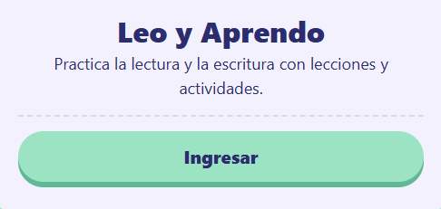
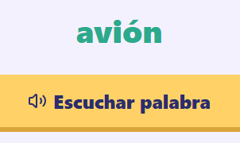
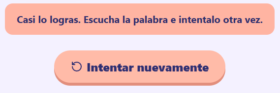
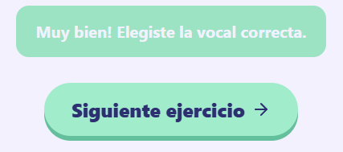

# ¡Aprende a usar Leo y Escribo!

Guía rápida para estudiantes · Universidad del Valle de Guatemala · 2026

## Vamos a leer

### 1. ¡Entra!

Pide ayuda para ingresar. Toca **Ingresar** en **Leo y Aprendo**.

### 2. ¡Despega!

Toca **¡Despegar!**

### 3. ¡Practica!

En vocales, toca **Comenzar actividad**.

### 4. ¡Escucha!

Toca **Escuchar palabra**. Di la palabra.

## Tu turno

### 5. ¡Elige!

Toca una letra. Luego toca **Comprobar respuesta**.

### 6. ¡Prueba otra vez!

Escucha de nuevo. Toca **Intentar nuevamente**.

### 7. ¡Sigue!

Toca **Siguiente ejercicio** cuando aciertes.

### 8. ¡Hasta pronto!

En **Inicio**, toca **Salir**. Pide ayuda para dejar listo el equipo.

