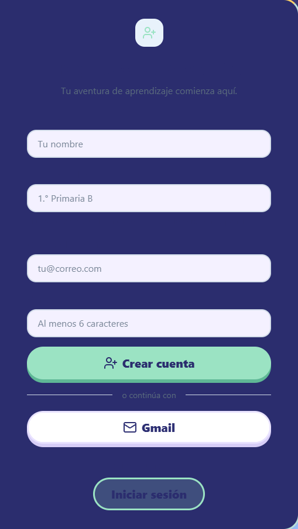
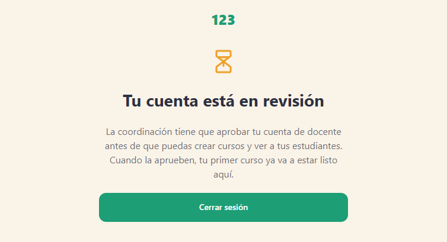
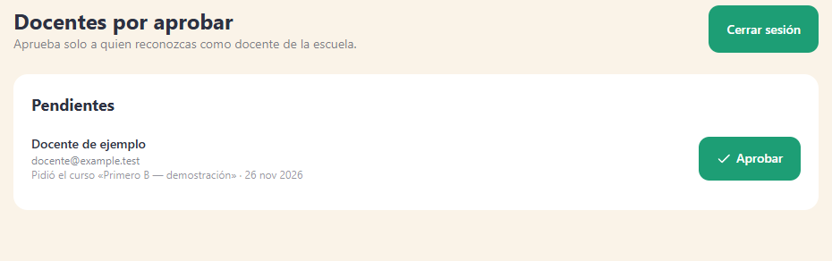
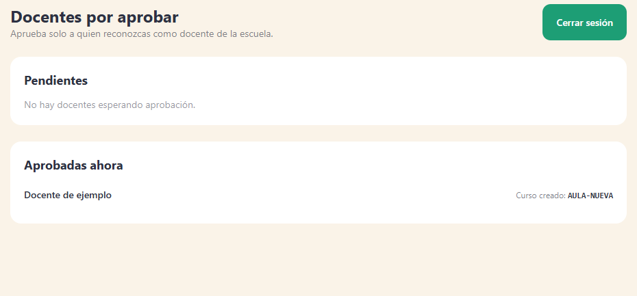
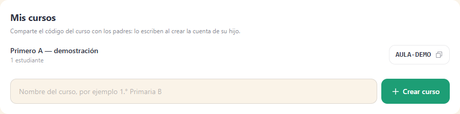
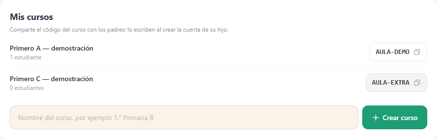
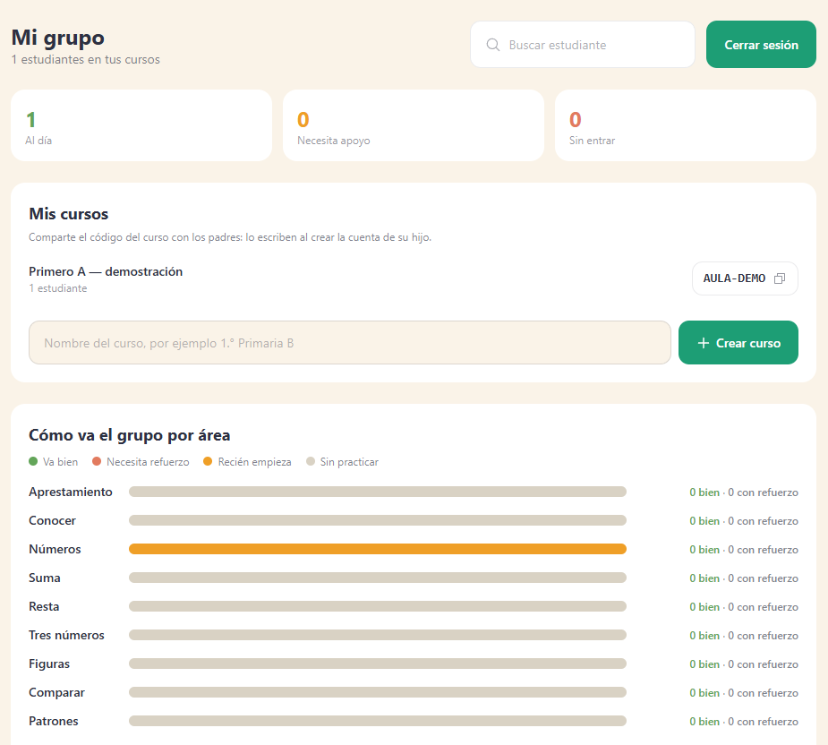
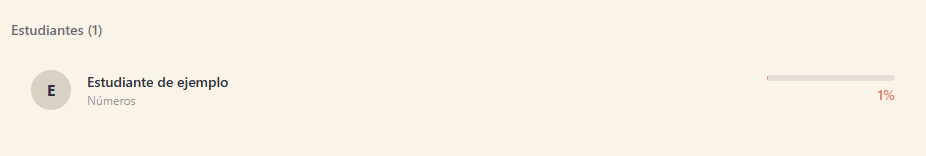
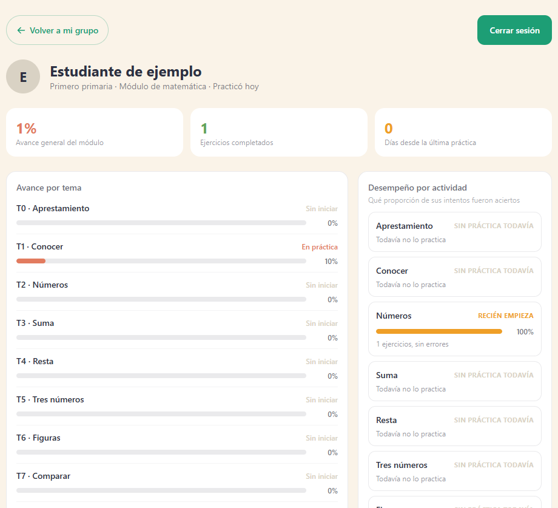

# Manual de administración y gestión de contenido

> Universidad del Valle de Guatemala · Facultad de Ingeniería  
> Proyecto de horas de extensión · Leo y Escribo  
> Versión 1.0 · 26 de noviembre de 2026
>
> Mishell Rosa Elvira Ciprian Jiménez · 231169  
> Ingrid Nina Alessandra Nájera Marakovits · 231088  
> Diego Alejandro Ramírez Velásquez · 23601  
> Adriana Martínez Fuentes · 24086

<!-- inicio-indice -->
## Contenido

- [1. Alcance y responsables](#1-alcance-y-responsables)
- [2. Matriz de roles y permisos](#2-matriz-de-roles-y-permisos)
- [3. Registrar y revisar una cuenta docente](#3-registrar-y-revisar-una-cuenta-docente)
- [4. Aprobar una solicitud desde Coordinación](#4-aprobar-una-solicitud-desde-coordinación)
- [5. Crear un curso y entregar el código](#5-crear-un-curso-y-entregar-el-código)
- [6. Consultar el grupo y la ficha de un estudiante](#6-consultar-el-grupo-y-la-ficha-de-un-estudiante)
- [7. Gestionar cambios de contenido](#7-gestionar-cambios-de-contenido)
- [8. Privacidad y operación institucional](#8-privacidad-y-operación-institucional)
- [9. Resolver problemas](#9-resolver-problemas)
- [10. Referencias](#10-referencias)
<!-- fin-indice -->

## 1. Alcance y responsables

Este manual reúne las acciones de gestión escolar disponibles en la plataforma compartida. Se ingresa desde **Learning App**, la pantalla de acceso de Comunicación. Los paneles de **Docente** y **Coordinación** se abren en Matemática. Las lecciones, imágenes y audios de Comunicación se mantienen mediante el repositorio y se publican con una versión de la aplicación.

La coordinación verifica solicitudes docentes. Cada docente comparte códigos de curso y consulta los datos de su propio grupo. La institución designa a quienes administran las cuentas de infraestructura, aprueba cambios de contenidos y resguarda datos y accesos. Las figuras se obtuvieron ejecutando las interfaces de ambos módulos con registros y cuentas ficticios y servicios simulados. La aplicación de cambios en el entorno institucional debe validarse allí por separado.

## 2. Matriz de roles y permisos

| Acción | Estudiante | Docente en revisión | Docente aprobado | Coordinación |
| --- | --- | --- | --- | --- |
| Practicar y ver su avance en Comunicación | Sí, con su cuenta escolar | Derivación al panel docente | Derivación al panel docente | Derivación al panel de coordinación |
| Registrar una solicitud de cuenta docente | Mediante alta de otra cuenta | Solicitud iniciada | Cuenta existente | Cuenta existente |
| Consultar o crear cursos y compartir código | Sin control de gestión | Espera aprobación | Sí, en **Mis cursos** | Código del aula inicial en la aprobación, si se genera |
| Consultar estudiantes y métricas de Matemática | Su propia experiencia | Espera aprobación | Sí, grupo vinculado y ficha individual | Su pantalla se centra en solicitudes |
| Ver y aprobar docentes pendientes | Sin acceso al panel | Sin permiso | Sin permiso | Sí, en **Docentes por aprobar** |
| Asignar el rol de coordinación | Gestión institucional externa | Gestión institucional externa | Gestión institucional externa | Sin control de edición de roles en el panel |
| Publicar contenidos de Comunicación | Flujo técnico institucional | Flujo técnico institucional | Flujo técnico institucional | Flujo técnico institucional |

La matriz describe las operaciones de interfaz y el contrato de roles encontrado en ambos proyectos. Los controles de acceso a datos dependen de las políticas aplicadas en la instancia de Supabase. El [manual técnico y de desarrolladores](manual-tecnico.md) documenta las tablas, la referencia SQL y los puntos que debe comprobar el responsable de infraestructura.

## 3. Registrar y revisar una cuenta docente

**Responsable.** Persona docente, con correo autorizado y nombre del primer curso.

1. Abra el enlace institucional del acceso compartido.
2. En **¿Eres docente?**, pulse **Regístrate aquí**.
3. Complete **Nombre**, **Nombre del aula**, **Correo electrónico** y **Contraseña**. Pulse **Crear cuenta**.
4. Si recibe el correo de confirmación, siga el enlace, vuelva al login compartido y pulse **Ingresar** con la cuenta confirmada.
5. Tras el primer ingreso al panel de Matemática, si la cuenta está pendiente se muestra **Tu cuenta está en revisión**. Contacte a coordinación e indique qué solicitud debe revisar.
6. Después de la aprobación, ingrese de nuevo. Compruebe que aparezca **Mi grupo** y busque el código del aula en **Mis cursos**.

**Resultado esperado.** La cuenta puede usar el panel docente después de la aprobación institucional. Si la cuenta queda en revisión tras una aprobación comunicada, compruebe el correo usado y pida al responsable de la plataforma que revise el estado antes de crear otra cuenta.

## 4. Aprobar una solicitud desde Coordinación

**Responsable.** Cuenta institucional con el rol de coordinación ya asignado. La creación o asignación del rol requiere intervención técnica autorizada. El panel carece de un control para alternar roles.

1. Entre en el login compartido con la cuenta de coordinación y pulse **Ingresar**. El acceso dirige a **Docentes por aprobar** en Matemática.
2. En **Pendientes**, compruebe el nombre y el correo de la solicitud con el registro interno de personal. Verifique también el curso solicitado.
3. Una vez confirmada la identidad, pulse **Aprobar** en esa fila y espere a que finalice. La acción cambia el estado de la cuenta y puede crear su aula inicial.
4. Busque la fila en **Aprobadas ahora**. Si se creó un curso, el código aparece en esa sección. El resumen **Aprobadas ahora** corresponde a las aprobaciones realizadas en la vista actual.
5. Comunique a la persona docente que puede volver a ingresar. Comparta el código de aula únicamente por el canal autorizado. Finalice con **Cerrar sesión**.

**Precaución.** Revise la fila antes de aprobar. La interfaz no ofrece una operación de revocación ni una segunda confirmación. Si hubo un error, informe al responsable de infraestructura y documente la solicitud afectada por el canal institucional. Si la lista está vacía, confirme que la persona docente verificó su correo y entró al panel por primera vez. El mensaje es **No hay docentes esperando aprobación** cuando no hay filas y la consulta fue satisfactoria.

## 5. Crear un curso y entregar el código

**Responsable.** Docente aprobado.

1. En **Mi grupo**, localice **Mis cursos**.
2. Escriba el nombre en el campo que muestra **Nombre del curso, por ejemplo 1.° Primaria B**. Use un nombre que diferencie el curso de otros grupos.
3. Pulse **Crear curso**. Espere a que se actualice la lista y compruebe el nombre y el código.
4. Pulse el botón con el código para copiarlo. Si el navegador impide copiar, transcriba el código que aparece en la fila.
5. Comparta el código con las familias del grupo. Al crear la cuenta del estudiante desde el acceso compartido, deben introducirlo en **Código de aula** y confirmar el correo.

**Resultado esperado.** El curso aparece con un código y un recuento de estudiantes vinculados. La pantalla permite crear y consultar cursos. El traslado de un estudiante, la corrección de un código usado en el alta, el cambio de titular del curso y su eliminación se tramitan con la institución. Un ajuste directo puede afectar quién ve los resultados y qué vínculo conserva el estudiante.

## 6. Consultar el grupo y la ficha de un estudiante

**Responsable.** Docente aprobado. Aplique esta consulta a estudiantes de su grupo y use un dispositivo privado.

1. Entre a **Mi grupo**.
2. Revise las cifras del encabezado y el bloque **Cómo va el grupo por área**. Las categorías de práctica ayudan a orientar la observación del aula.
3. Escriba el nombre en **Buscar estudiante**. Abra la fila de la persona que corresponda.
4. En la ficha, revise **Avance general del módulo**, **Ejercicios completados**, **Días desde la última práctica**, **Avance por tema** y **Desempeño por actividad**.
5. Vuelva a **Mi grupo** para continuar. Use **Cerrar sesión** cuando termine.

El panel calcula y presenta **Matemática**. Para revisar lectura, acompañe al estudiante en **Mi progreso** de Comunicación. Esa vista está orientada a su propio avance. Las pantallas revisadas ofrecen consultas visuales. Los reportes descargables y los cambios de datos personales requieren un proceso institucional externo.

## 7. Gestionar cambios de contenido

El catálogo de Comunicación incluye unidades, lecciones, ejercicios y recursos estáticos. Su actualización se coordina entre el equipo pedagógico y el personal técnico. El panel escolar disponible sirve para cuentas, cursos y seguimiento de Matemática.

| Solicitud | Responsable y procedimiento |
| --- | --- |
| Corregir una palabra, una instrucción o una respuesta | El docente identifica unidad, letra, actividad, página del libro y cambio esperado. El mantenedor ubica la definición y prueba el nuevo ejercicio |
| Incorporar o sustituir una imagen | El equipo pedagógico aprueba pertinencia y créditos. El mantenedor incorpora la imagen al repositorio y revisa su presentación y texto alternativo |
| Grabar o sustituir un audio | El docente coteja el guion y pronunciación. El mantenedor comprueba ruta, transcripción, volumen y disponibilidad del botón |
| Incorporar una lección o cambiar su orden | El responsable pedagógico aprueba alcance y precedencia. El mantenedor modifica la secuencia, revisa los desbloqueos y comprueba el avance previo |
| Retirar contenido o cambiar un identificador | Documente el motivo y las lecciones afectadas. Revise la lectura del progreso histórico y el acceso a la siguiente entrada antes de publicar |

1. Registre la solicitud con una captura sin datos personales y la ubicación exacta.
2. Pida a la persona responsable de contenidos que valide el cambio contra *Leo y escribo, Paso 2*. Revise el permiso y atribución de cada recurso que vaya a distribuirse.
3. En un entorno de pruebas, escuche el audio, compruebe aciertos y reintentos y llegue al cierre de la actividad.
4. Compruebe el efecto sobre estudiantes que ya habían empezado o completado la lección con cuentas de ejemplo.
5. Confirme la versión aprobada, fecha, responsable y comprobaciones antes de que el equipo autorizado la publique. Para la implementación, consulte los capítulos 14 a 21 del [manual técnico y de desarrolladores](manual-tecnico.md).

## 8. Privacidad y operación institucional

- Use cuentas individuales para docentes y coordinación. Verifique que el acceso corresponda a la persona y al grupo correctos antes de ver la ficha de un menor.
- Comparta códigos de aula por el canal escolar autorizado. Mantenga los nombres, correos y resultados fuera de chats abiertos, capturas compartidas o archivos de distribución.
- Conserve las aprobaciones y correcciones importantes en el registro interno del centro, con fecha, persona autorizada y motivo. Use datos ficticios al pedir ayuda técnica o reproducir una incidencia.
- Al terminar en un dispositivo compartido, use **Cerrar sesión** en Matemática. En Comunicación, **Salir** abre el acceso, y la sesión de ese origen puede seguir activa. Cierre la ventana privada o el perfil que usó antes de entregar el equipo.
- Pida al equipo de infraestructura un inventario de cuentas responsables, respaldos, retención y procedimientos de recuperación. Los cambios de roles, la gestión de Auth y las correcciones masivas se realizan con autorización institucional.

La entrega no incluye credenciales ni datos de estudiantes. Las operaciones probadas en la interfaz usan cambios en memoria y no certifican los permisos de la instancia alojada. La prueba de permisos debe incluir una cuenta docente aprobada, otra en revisión, coordinación y un estudiante de otro grupo.

## 9. Resolver problemas

| Problema o pregunta | Qué comprobar y qué hacer |
| --- | --- |
| El acceso docente se queda en el selector de proyectos | Confirme que usó la cuenta docente. Pida al responsable que revise el perfil y la conexión entre Comunicación y Matemática |
| Abrí **Docentes por aprobar** y no veo la solicitud | Confirme el primer ingreso de la persona docente después de validar el correo. Revise si la solicitud ya fue aprobada o si se mostró un error |
| Pulsé **Aprobar**, pero la solicitud sigue pendiente | Lea el mensaje de la fila y espere a que concluya la acción. Consulte el estado institucional si el problema se repite |
| La lista de **Mis cursos** no muestra el aula | Compruebe que su cuenta esté aprobada. Si creó el curso, revise el aviso de error y vuelva a abrir la lista antes de repetir el alta |
| Una familia usó un código incorrecto | Verifique cuál era el código correcto y escale la corrección. Evite crear cuentas duplicadas para intentar resolver el vínculo |
| El estudiante está en el grupo sin actividad registrada | Confirme el módulo que practicó y el acceso de la cuenta. La ficha docente mide Matemática |
| Quiero editar una lección o retirar un audio | Solicite un cambio de contenido con la página, lección y recurso. El equipo técnico prepara y prueba la nueva versión |
| Necesito una baja, cambio de rol o exportación | Solicite la operación al responsable institucional. Confirme el alcance y las consecuencias sobre el historial |

## 10. Referencias

- [Manual de usuario](manual-usuario.md) para instrucciones de alta de estudiantes, ingreso, navegación y progreso propio.
- [Manual técnico y de desarrolladores](manual-tecnico.md) para configuración, almacenamiento, políticas y mantenimiento de contenido.
- Ministerio de Educación de Guatemala (2020). *Leo y escribo, Paso 2* para primero de primaria. [Copia pública oficial, parte 1](https://aprendoencasayenclase.mineduc.gob.gt/wp-content/uploads/Leo_y_escribo_Paso_2G_-_parte1.pdf).
