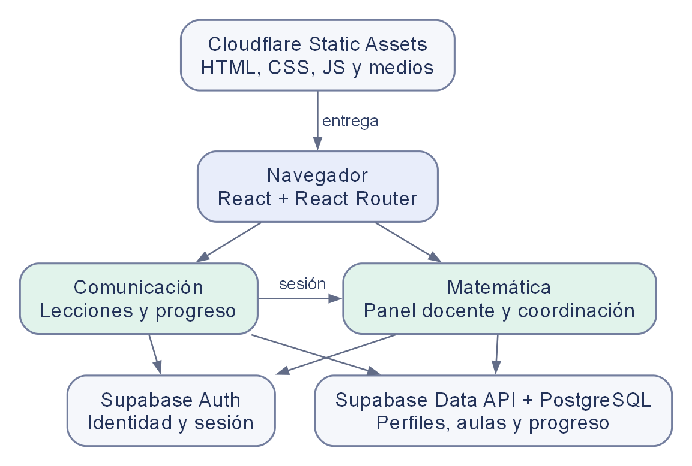
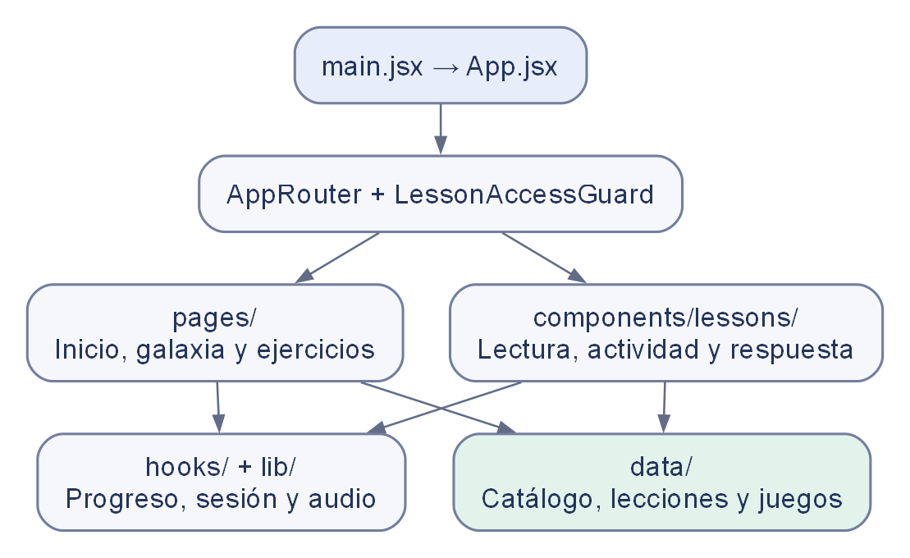
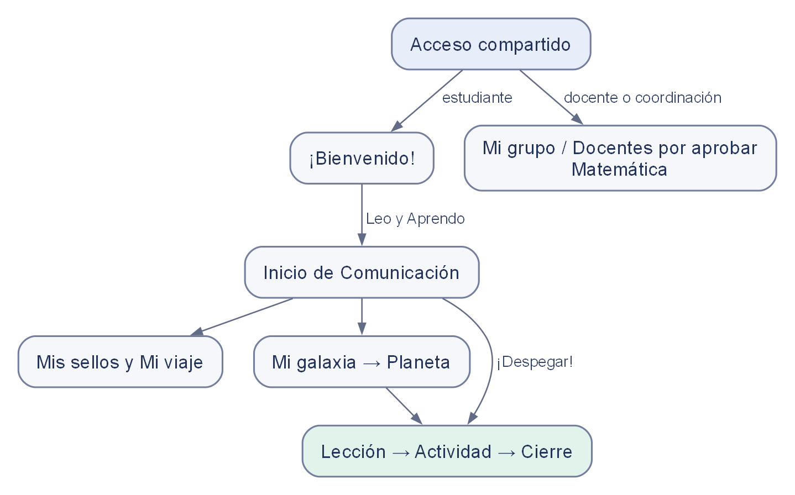
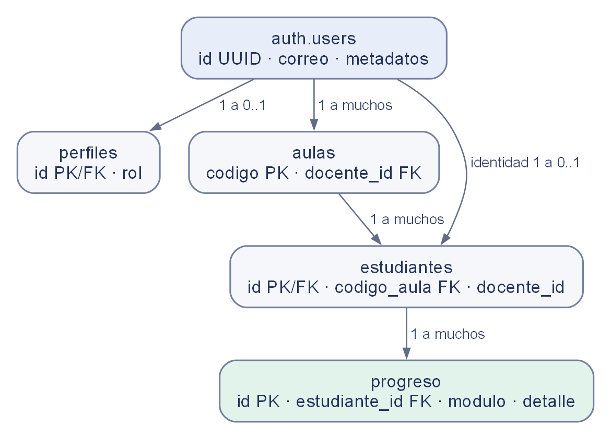
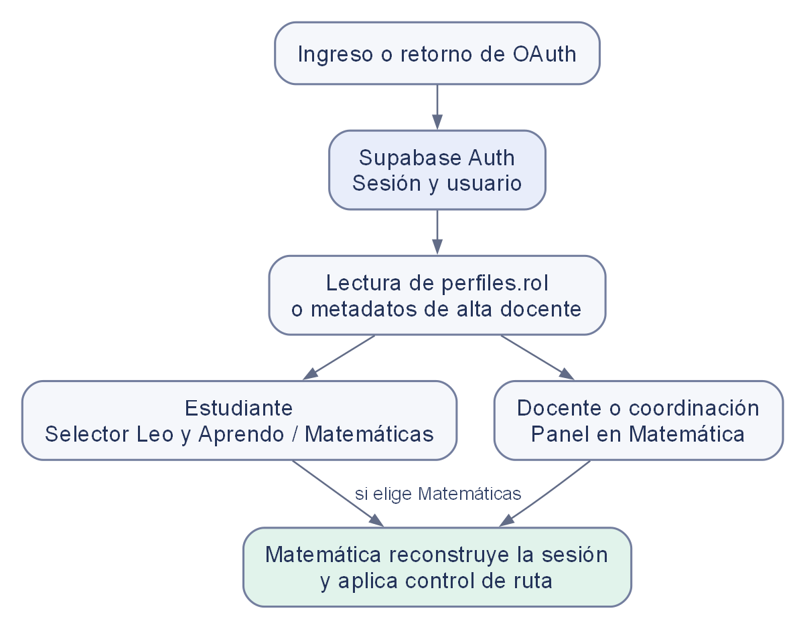
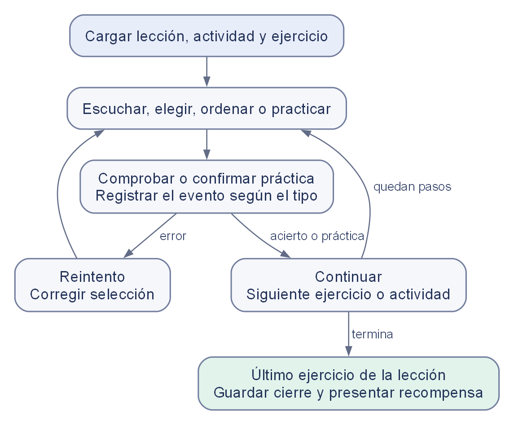
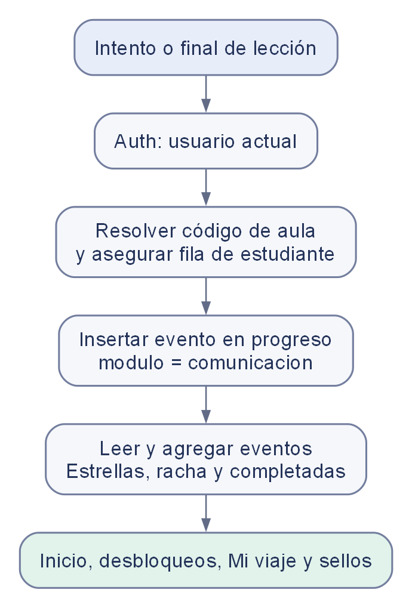
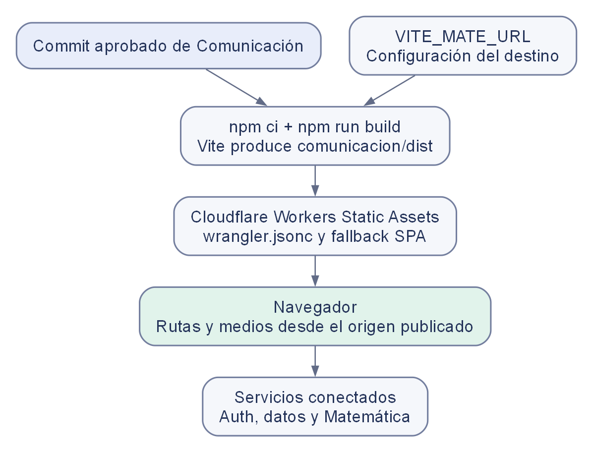

# Manual técnico y de desarrolladores

> Universidad del Valle de Guatemala · Facultad de Ingeniería  
> Proyecto de horas de extensión · Leo y Escribo  
> Versión 1.0 · 26 de noviembre de 2026
>
> Mishell Rosa Elvira Ciprian Jiménez · 231169  
> Ingrid Nina Alessandra Nájera Marakovits · 231088  
> Diego Alejandro Ramírez Velásquez · 23601  
> Adriana Martínez Fuentes · 24086

<!-- inicio-indice -->
## Contenido

- [1. Introducción](#1-introducción)
- [2. Descripción general del sistema](#2-descripción-general-del-sistema)
- [3. Tecnologías utilizadas](#3-tecnologías-utilizadas)
- [4. Arquitectura del sistema](#4-arquitectura-del-sistema)
- [5. Estructura del repositorio](#5-estructura-del-repositorio)
- [6. Requisitos técnicos](#6-requisitos-técnicos)
- [7. Instalación y configuración](#7-instalación-y-configuración)
- [8. Ejecución local](#8-ejecución-local)
- [9. Frontend y navegación](#9-frontend-y-navegación)
- [10. Servicios y lógica de negocio](#10-servicios-y-lógica-de-negocio)
- [11. Modelo de datos y preparación del entorno](#11-modelo-de-datos-y-preparación-del-entorno)
- [12. API y comunicación entre servicios](#12-api-y-comunicación-entre-servicios)
- [13. Autenticación, permisos y privacidad](#13-autenticación-permisos-y-privacidad)
- [14. Sistema de contenido educativo](#14-sistema-de-contenido-educativo)
- [15. Actividades interactivas](#15-actividades-interactivas)
- [16. Audios, imágenes y tipografía](#16-audios-imágenes-y-tipografía)
- [17. Registro de progreso](#17-registro-de-progreso)
- [18. Identidad visual y accesibilidad](#18-identidad-visual-y-accesibilidad)
- [19. Extensión y modificación](#19-extensión-y-modificación)
- [20. Pruebas y validación](#20-pruebas-y-validación)
- [21. Compilación y despliegue](#21-compilación-y-despliegue)
- [22. Mantenimiento y continuidad](#22-mantenimiento-y-continuidad)
- [23. Solución de problemas técnicos](#23-solución-de-problemas-técnicos)
- [24. Limitaciones y recomendaciones futuras](#24-limitaciones-y-recomendaciones-futuras)
- [25. Glosario y referencias](#25-glosario-y-referencias)
<!-- fin-indice -->

## 1. Introducción

Leo y Escribo es el módulo de Comunicación y Lenguaje desarrollado para las horas de extensión de la Facultad de Ingeniería de la Universidad del Valle de Guatemala. Adapta actividades de *Leo y escribo, Paso 2* del Ministerio de Educación de Guatemala para primero de primaria. El trabajo con fonemas, sílabas, palabras y cuentos concentra la práctica. El Planeta Escritor incorpora tres lecciones con selección, composición oral y reconocimiento de palabras.

Este manual permite instalar la aplicación, mantener sus recursos y sostener el intercambio de sesión con Matemática. La referencia de Comunicación es el commit `7e4224f` de `main`. La integración docente se cotejó con el repositorio vecino `frontend_math`, commit `c9fda4b`. En el capítulo 20 se detallan los resultados de ejecución y las diferencias respecto de un entorno conectado.

## 2. Descripción general del sistema

El punto de entrada es el acceso compartido **Learning App**. Un estudiante llega a **¡Bienvenido!**, elige **Leo y Aprendo** y entra al inicio de Comunicación. Desde allí sigue la misión recomendada o explora **Mi galaxia**. Completar la actividad final de una lección permite avanzar en la secuencia. **Mi progreso** muestra el recorrido y **Sellos** reúne recompensas por lección.

Una cuenta con rol `docente` o `coordinacion` se dirige al módulo de Matemática. Aunque ambas aplicaciones comparten autenticación y algunas tablas, el panel docente consultado filtra el avance para Matemática. El estudiante también puede abrir Matemática desde el selector. El acompañamiento familiar consiste en apoyar el ingreso, el uso del código de aula y la práctica.

| Perfil | Punto de entrada | Alcance observable |
| --- | --- | --- |
| Estudiante | Login compartido y selector | Lecciones, juegos, avance propio y sellos en Comunicación |
| Docente | Login compartido y panel externo | Alta y revisión de cuenta, cursos, códigos, grupo y detalle de Matemática |
| Coordinación | Login compartido y panel externo | Lista y aprobación de solicitudes docentes |
| Institución mantenedora | Cuentas de infraestructura autorizadas | Gestión del código, despliegue, políticas y recursos mediante los servicios correspondientes |

## 3. Tecnologías utilizadas

| Tecnología | Versión fijada o condición | Función |
| --- | --- | --- |
| JavaScript, JSX, HTML y CSS | Aplicación ESM y JSX | Código de páginas, datos, estilos y documento inicial |
| React y React DOM | 19.2.7 | Componentes, renderizado y estado |
| React Router DOM | 7.18.1 | Rutas de navegador y navegación SPA |
| Vite | 8.1.4 | Servidor de desarrollo, vista previa y compilación |
| Plugin React para Vite | 6.0.3 | Integración React en Vite |
| Tailwind CSS y plugin Vite | 4.3.2 | Utilidades CSS, complementadas por las hojas propias |
| Lucide React | 1.24.0 | Iconos de controles y navegación |
| Supabase JS | 2.110.2 | Autenticación, sesión y acceso a datos |
| PostgreSQL en Supabase | Versión del servidor por confirmar | Datos de perfiles, aulas, estudiantes y progreso |
| ESLint | 10.7.0 | Análisis estático y reglas para React |
| Node.js y npm | 22.14.0 y 10.9.2 en la revisión | Instalación, compilación y pruebas con `node:test` |
| Cloudflare Workers Static Assets | Wrangler en configuración, compatibilidad `2025-01-01` | Entrega de archivos estáticos y resolución de rutas SPA |

La fuente de versiones es `comunicacion/package-lock.json`. `package.json` declara rangos, por lo que `npm ci` es la opción para reproducir el árbol fijado. Google Fonts sirve Andika y Baloo 2 si el navegador puede cargar el recurso. La voz hablada en ciertos ejercicios usa APIs del navegador.

## 4. Arquitectura del sistema

Comunicación es una aplicación de página única. El navegador carga HTML, JavaScript, CSS e imágenes. React Router decide la vista; los componentes leen contenidos JavaScript y consultan Supabase desde el cliente cuando necesitan la sesión o el progreso. PostgreSQL conserva los datos de las cuentas escolares; el contenido educativo de Comunicación se entrega en el repositorio y en el paquete web.



El límite entre aplicaciones es el origen web. La navegación a Matemática transfiere la sesión y el segundo módulo reconstruye su sesión antes de montar las rutas. Los recursos de Comunicación se resuelven en su propio origen.



`App` observa cambios de sesión. `AppRouter` monta el fondo común, el control de acceso didáctico y las rutas. Las páginas usan componentes genéricos para audio, opciones, lectura, progreso y recompensas. La comunicación con el servicio externo se concentra en `src/lib`.

## 5. Estructura del repositorio

```text
Leo_y_Escribo/
  README.md
  wrangler.jsonc                    # compilación desde la raíz
  docs/                             # documentación final
  comunicacion/
    index.html
    package.json / package-lock.json
    vite.config.js / eslint.config.js
    wrangler.jsonc / .env.example
    src/
      main.jsx / App.jsx
      routes/AppRouter.jsx
      pages/
      components/
      data/ / hooks/ / lib/ / styles/
    public/audio/ / public/images/
    sql/newstructure.sql
    tests/
    docs/                           # notas previas de lecciones y operación
```

| Ubicación | Responsabilidad |
| --- | --- |
| `index.html`, `src/main.jsx` | Raíz del documento, fuentes, entrada de Vite y montaje React |
| `src/App.jsx`, `src/routes/AppRouter.jsx` | Observación de Auth, composición y rutas |
| `src/pages` | Pantallas y ejercicios específicos, incluidos seis juegos de cierre |
| `src/components` | Controles, navegación, prácticas, lecturas, voz y recompensas |
| `src/data` | Unidades, etiquetas, paleta, lecciones, vocabulario, claves de respuesta y sellos |
| `src/lib`, `src/hooks` | Auth, progreso, redirección externa, nombre del estudiante y audio |
| `src/styles` | Temas, tipografía, componentes y variantes por pantalla |
| `public` | Activos servidos en el origen web, con rutas desde `/` |
| `sql` | Script de ampliación de un esquema compartido ya existente |
| `tests` | Pruebas de datos, rutas, recursos, respuestas y orden curricular |

El proyecto de Matemática tiene su propio repositorio, dependencias, aplicación y carpeta `supabase`. Para trabajar en la integración deben conservarse las referencias de ambos repositorios.

## 6. Requisitos técnicos

Use Git, Node.js 22.14 o posterior de la rama 22 compatible con las dependencias, y npm compatible con el archivo de bloqueo. El mínimo conjunto deducido del lock para la rama 22 es 22.13, por ESLint. Para reproducir la revisión use Node 22.14.0 y npm 10.9.2. Reserve un navegador Chromium reciente para la validación inicial. La voz, el portapapeles y la grabación dependen del navegador y del contexto seguro. Para una prueba de extremo a extremo se requiere un proyecto Supabase de pruebas provisionado, una aplicación de Matemática compatible, cuentas ficticias y acceso institucional a la configuración. Cloudflare y Wrangler se requieren para publicar en la infraestructura configurada.

## 7. Instalación y configuración

Desde la carpeta donde desea guardar el repositorio, clone el remoto registrado. Si el acceso al remoto requiere autorización, use la cuenta institucional a la que se concedió acceso.

```bash
git clone https://github.com/Ninaswiftie09/Leo_y_Escribo.git
cd Leo_y_Escribo/comunicacion
npm ci
```

1. Compare `node --version` y `npm --version` con las versiones del capítulo 6. Ejecute el resto de comandos de Comunicación desde `comunicacion/`.
2. Cree `.env.local` si necesita cambiar `VITE_MATE_URL`. En PowerShell puede iniciar con `Copy-Item .env.example .env.local`. Vite carga los valores al iniciar o compilar; reinicie o recompile tras cambiarlos.
3. Para las pruebas integradas, pida al responsable de datos el esquema y las políticas aplicadas y cree un entorno separado. En un checkout de pruebas, configure ambos clientes para ese proyecto usando su clave publicable. `src/lib/supabaseClient.js` usa constantes en el código. Evite reutilizar el proyecto compartido que viene configurado para realizar altas o pruebas de escritura.
4. Revise la URL del login, las redirecciones de Auth, la confirmación por correo y, si corresponde, el proveedor Google desde la configuración de pruebas. Valide que Matemática apunte al mismo proyecto de Auth.
5. Prepare una cuenta de coordinación de prueba siguiendo el mecanismo autorizado de la institución, una solicitud docente y un aula aprobada. Use el código de esa aula para crear una cuenta de estudiante de ejemplo. El catálogo de Letras se carga con los archivos de `src/data`; viene incluido en el build.
6. Ejecute `npm run build` y `node --test tests/*.test.mjs`. Para el arranque y la revisión del navegador, siga el capítulo 8.

| Nombre | Servicio y propósito | Condición | Ejemplo seguro |
| --- | --- | --- | --- |
| `VITE_MATE_URL` | Comunicación. Origen de Matemática | Opcional en local, necesario para elegir el destino desplegado | `http://localhost:5174` |
| `VITE_LOGIN_URL` | Matemática. URL completa del acceso compartido | Opcional en local, necesario para volver al login desplegado | `http://localhost:5173/login` |
| `VITE_USE_MOCK_AUTH` | Entrada histórica de `.env.example` de Comunicación | Sin lector en `src`. El login invoca Supabase | `false` |
| `SUPABASE_URL` | Constante del cliente web, URL del proyecto compartido | Requerida en `supabaseClient.js` | `https://proyecto-pruebas.example.test` |
| `SUPABASE_PUBLISHABLE_KEY` | Constante del cliente web, clave publicable del mismo proyecto | Requerida en `supabaseClient.js` | `<clave-publicable-de-pruebas>` |

Las variables prefijadas con `VITE_` pueden quedar en los archivos servidos al navegador. Mantenga las claves de servicio y las contraseñas en la custodia de infraestructura. El capítulo 11 identifica las dependencias que impiden usar `newstructure.sql` como inicialización desde cero.

## 8. Ejecución local

Ejecute Comunicación en una terminal desde `Leo_y_Escribo/comunicacion`.

```bash
npm run dev -- --host localhost --port 5173 --strictPort
```

Abra `http://localhost:5173/login`. Para revisar el flujo docente y de coordinación, instale y levante el repositorio de Matemática en otra terminal, desde su propia raíz.

```bash
npm ci
npm run dev -- --host localhost --port 5174 --strictPort
```

Abra el login de Comunicación, ingrese con una cuenta de pruebas y compruebe el destino según el perfil. Mantenga el mismo nombre de host en la configuración, el navegador y las URLs de retorno. Use **Ctrl+C** en cada terminal para detener Vite. Para comprobar la salida compilada de Comunicación desde su carpeta:

```bash
npm run build
npm run preview -- --host localhost --port 4173 --strictPort
```

`npm run preview` abre `http://localhost:4173` por defecto. Si prueba la sesión integrada con esa vista previa, configure el retorno de Matemática y las redirecciones de Auth para ese origen de pruebas. Vite Preview sirve para revisar el paquete localmente.

## 9. Frontend y navegación

| Ruta | Vista o familia de vistas |
| --- | --- |
| `/`, `/login` | Acceso, alta de estudiante y formulario docente |
| `/welcome` | Selector de proyectos y salida por rol |
| `/home` | Misión sugerida, estrellas, racha y accesos |
| `/lecciones`, `/lecciones/unidad/:unitId` | Sistema de planetas y lecciones dentro de la unidad |
| `/lecciones/<id>`, `/actividad/<id>` | Lectura, ejercicios, juegos y cierre |
| `/unidad-1/juguemos-palabras`, `/unidad-2/subidas-resbalones` | Juegos finales con ruta propia |
| `/unidad-3/domino-palabras`, `/unidad-2/repaso` | Dominó y repaso de la unidad |
| `/unidad-{1,3,4,5}/palabras-practica` | Páginas de vocabulario mediante plantilla |
| `/progreso`, `/sellos` | Mi viaje y Mis sellos |



`useState` y `useRef` guardan selección, posición, intentos y estado de guardado de cada pantalla. `useStudentProgress` obtiene el resumen e incluye una caché en memoria para los indicadores. `BottomNav`, `BackButton`, `Button`, `Card`, `LessonAudioButton`, `StoryCard`, `ProgressBar` y `RewardScreen` son puntos de reutilización.

`LoginPage.jsx` usa campos requeridos, email con formato de navegador y contraseña con mínimo de seis caracteres. El registro de estudiante pide nombre y código de aula. El registro docente pide nombre y nombre del aula. La existencia del aula se valida al intentar vincular al estudiante. En lecciones, las páginas usan controles contextuales y transiciones a la siguiente fase después de una respuesta aceptada.

## 10. Servicios y lógica de negocio

| Archivo en `src/lib` | Operación |
| --- | --- |
| `supabaseClient.js` | Crea la instancia del SDK con configuración pública del proyecto |
| `auth.js` | Registro con metadatos, login por contraseña y solicitud OAuth Google |
| `irAMatematica.js` | Lee el rol, selecciona panel y transfiere sesión. Crea cuenta de Auth docente pendiente |
| `progreso.js` | Lee usuario y aula, asegura fila del estudiante, inserta resultados y agrega progreso |
| `audioPlayer.js`, `audioEvents.js` | Reproductor compartido y eventos de estado |
| `highlightLetter.jsx` | Resalta grafías de práctica dentro de palabras y lecturas |

Esta implementación utiliza el servicio administrado de Supabase para operaciones de backend. Las transiciones didácticas y las reglas de respuesta están en el navegador. Las lecturas de progreso pueden devolver una colección vacía ante falta de sesión o error. `registrarProgreso` devuelve `{ error, skipped }`; algunas pantallas esperan la escritura y permiten reintentar, mientras varias actividades antiguas continúan sin mostrar un error de persistencia. Para soporte, revise primero el estado de la sesión y del vínculo del aula antes de concluir que el estudiante perdió avance.

## 11. Modelo de datos y preparación del entorno

| Entidad | Campos usados y tipos respaldados por el esquema base de referencia | Relación |
| --- | --- | --- |
| `auth.users` | `id` UUID, correo, metadatos JSON de Auth | Identidad de sesión, estudiante, docente o coordinación |
| `perfiles` | `id` UUID PK, `nombre` text, `rol` text, `creado_en` timestamptz | La identidad referencia Auth. Aprobación docente prevista por migración 013 |
| `aulas` | `codigo` text PK, `docente_id` UUID, `creado_en` timestamptz; `nombre` usado en Matemática | Un docente puede tener varias aulas |
| `estudiantes` | `id` UUID PK, `nombre` text, `codigo_aula` text, `docente_id` UUID, `avatar` text, `creado_en` timestamptz | Vincula Auth y aula. El cliente asigna el docente a partir del aula |
| `progreso` | `id` bigint identity PK, `estudiante_id` UUID, `modulo` text, `actividad` text, `correcto` boolean, `intentos` integer, `detalle` jsonb, `creado_en` timestamptz | Cada estudiante puede tener muchos eventos y el módulo separa los recorridos |

El esquema del repositorio vecino define las llaves foráneas desde `perfiles` y `estudiantes` a Auth, desde `aulas.docente_id` y `estudiantes.docente_id` a Auth, desde `estudiantes.codigo_aula` a `aulas.codigo` y desde `progreso.estudiante_id` a `estudiantes.id`. `modulo` admite `comunicacion` y `matematica`. La referencia SQL es parcial y el estado efectivo de políticas, restricciones y columnas del proyecto alojado requiere verificación institucional.



`comunicacion/sql/newstructure.sql` amplía tablas existentes, migra relaciones y agrega `roles`, `perfil_roles`, `plataformas`, `perfil_plataformas`, `familia_estudiantes`, `aula_plataformas`, `aula_docentes`, `aula_estudiantes`, `unidades`, `lecciones`, `actividades` y agregados de progreso. También añade referencias de plataforma, lección y actividad a `progreso`, activa RLS en varias tablas nuevas y define un disparador de sincronización de plataforma. El script parte de tablas y columnas previamente creadas. La SPA continúa usando el contrato anterior. El catálogo y los criterios que usa Comunicación siguen en JavaScript.

En `frontend_math/supabase` están `schema.sql` y las migraciones numeradas. `013_aprobacion_docentes.sql` documenta funciones y políticas de aprobación. Hay referencias a cambios previos cuya disponibilidad o aplicación debe cotejarse. El esquema base conserva notas sobre diferencias con la instancia. El orden de migración efectivo y el conjunto de políticas aplicadas deben obtenerse de una exportación autorizada antes de provisionar otra instancia. Los datos de un aula de pruebas se crean para ese entorno y se administran con las cuentas autorizadas.

## 12. API y comunicación entre servicios

El SDK llama a Supabase Auth y a la API de datos que expone PostgreSQL. Los nombres siguientes describen las operaciones observadas en el cliente. El servicio usa la clave publicable y, en operaciones del usuario, su sesión. Autorización y códigos de error dependen de Auth, PostgREST y las políticas de la instancia.

| Operación | Solicitud del SDK | Datos y resultado de interés |
| --- | --- | --- |
| Registro e ingreso | `auth.signUp`, `auth.signInWithPassword` | Correo y contraseña. Registro de estudiante incluye `full_name`, `codigo_aula`. Registro docente envía `full_name`, `registro_docente` |
| OAuth, usuario y sesión | `signInWithOAuth`, `getUser`, `getSession`, `signOut` | Google redirige a `/welcome`; usuario y sesión determinan el acceso |
| Consulta de rol | GET en `perfiles` | `select('rol').eq('id', user.id).maybeSingle()`; rol o ausencia de fila |
| Búsqueda de aula | GET en `aulas` | `docente_id` mediante `ilike('codigo', codigoAula)`; aula válida para vínculo |
| Alta inicial de estudiante | POST en `estudiantes` mediante upsert | ID Auth, nombre, código y docente; maneja duplicado de ID sin actualizar la fila existente |
| Escritura de progreso | POST en `progreso` | Módulo, estudiante, actividad, acierto, intentos y detalle; la función devuelve error u omisión |
| Lectura de avance | GET en `progreso` | Datos del estudiante y del módulo, cronología descendente |
| Panel docente y coordinación, en Matemática | RPC `registrar_docente`, `crear_aula`, `docentes_pendientes`, `aprobar_docente` | Entrada de registro, nombre de curso o ID de solicitud según función; código de aula o lista de pendientes |

Este ejemplo ficticio ilustra el cuerpo del evento que emite el cliente. La aplicación obtiene el ID de la sesión.

```json
{
  "modulo": "comunicacion",
  "estudiante_id": "00000000-0000-4000-8000-000000000001",
  "actividad": "vocales-inicial",
  "correcto": true,
  "intentos": 2,
  "detalle": { "leccionId": "vocales" }
}
```

Una lectura devuelve filas con `actividad`, `correcto`, `intentos`, `detalle` y `creado_en`. `maybeSingle()` devuelve una fila o ausencia; una respuesta ambigua o una política que deniegue el acceso producen error. Una escritura exitosa se comprueba por el resultado del SDK y la lectura posterior. El cliente contempla falta de sesión, código ausente, aula inexistente, rechazo por política y conflicto de integridad si falta la fila de estudiante. Los códigos HTTP y cuerpos efectivos de la instancia aún requieren una prueba contra Supabase de pruebas.

## 13. Autenticación, permisos y privacidad



1. El formulario llama a Auth y procesa el resultado. Tras el alta por correo se muestra el aviso de confirmación. Google usa OAuth cuando el proveedor y la URL de retorno están habilitados.
2. La SPA obtiene el usuario y consulta `perfiles.rol`. Un registro con `registro_docente.pendiente` también se enruta al panel. El resto ve el selector de módulos tras ingresar.
3. El puente toma la sesión y navega al destino con los tokens en el fragmento de URL. Matemática elimina ese fragmento del historial actual y llama a `setSession`. Sus rutas docentes y de coordinación usan `RequireSession` con rol.
4. En Comunicación, `LessonAccessGuard` protege la secuencia de lecciones por avance. La autenticación de los datos depende del servicio. El router permite presentar pantallas como inicio o progreso y la primera lección con avance vacío. Una ruta visible por sí sola carece de autoridad para exponer datos.

El SQL de referencia compartido define RLS para las tablas escolares. La migración 013 limita la lectura docente a cuentas aprobadas con vínculo y controla las RPC de coordinación. El alcance desplegado, incluidas posibles políticas anteriores, debe cotejarse en la instancia de pruebas. La institución debe validar aislamiento entre aulas y cuentas, custodia de la cuenta de coordinación y configuración correcta de los destinos de sesión. Evite registrar URLs de transferencia, guardar sesiones en capturas o almacenar claves de servicio en un frontend.

Los eventos contienen datos escolares de menores. Limite acceso, exportación, retención y reproducibilidad de respaldos a los responsables autorizados. La grabación de voz de los ejercicios compatibles vive como un Blob local de la pantalla. El código revoca la URL al reemplazarla o desmontar y apaga el micrófono al salir. Se entrega una revisión de implementación, con la aprobación institucional de tratamiento de datos y la auditoría de accesibilidad todavía pendientes.

## 14. Sistema de contenido educativo

`src/data/units.js` fija las entradas y su orden. `planets.js` presenta las siete unidades como planetas y representa las vocales con Burbuja, que pertenece a la Unidad 1. Las entradas del catálogo incluyen ID, página de referencia, título, ruta y disponibilidad. Los rótulos y glifos se concentran en `lessonLabels.js`.

| Unidad y planeta | Contenido que integra su recorrido |
| --- | --- |
| 1 Nube, con vocales en Burbuja | Vocales, m, l, s, y como conjunción, r, p, t, n, Juguemos con las palabras y repaso |
| 2 Volcán | c, q, d, sílabas inversas con l, s y n, pl, pr, repaso, Subidas y resbalones |
| 3 Selva | b, j, tr, bl, br, ch, Dominó de palabras y repaso |
| 4 Miel | cl, cr, f, v, rr, ñ, repaso y Memoria |
| 5 Cristal | dr, g, h, z, ll, gr, gl, repaso, El gato y el ratón |
| 6 Dulce | x, y como letra, k, w, fr, fl, ge/gi, ce/ci, güe/güi y Abecedario |
| 7 Escritor | Palabras con ll-y, q-c y h, incluidas selección, lectura y crucigrama |

Las primeras lecciones agrupan información en archivos propios, por ejemplo `lLectura.js`, `lSilabas.js` y `lCompletar.js`. Sus páginas manejan varias fases en un mismo componente. Las lecciones con estructura compartida exportan un objeto con `id`, `unitId`, `pages`, `reading`, `activities` y `feedback`. `reading` puede incluir párrafos, preguntas, audio, imagen y atribución. Cada actividad tiene ID, título y ejercicios. El router genera las rutas de estas lecciones a partir de los IDs.

Este fragmento de `fData.js` muestra cómo se reutiliza el constructor de selección. Los IDs de opción permanecen estables aunque cambie su orden.

```js
select(
  'reconocer-mayuscula', 144, 'Selecciona la F mayúscula.',
  [
    { id: 'mayuscula', label: 'F' },
    { id: 'minuscula', label: 'f' },
  ],
  ['mayuscula'],
)
```

`createBookContent(lessonId)` centraliza constructores de palabra, sílaba, instrucción y ejercicio. Para palabras ilustradas construye `/images/lecciones/<id>/<slug>.png`. Las referencias de audio incluyen la ruta, el texto exacto de la grabación y su categoría. Un cambio de ID altera rutas, relación con registros históricos y asignación de sellos; conserve el ID cuando solo edite la redacción.

## 15. Actividades interactivas



### Motor de lecciones

`BookLessonActivity.jsx` resuelve la actividad y el índice local. Monta un ejercicio con su ID como clave. Tras el último ejercicio de una actividad abre la siguiente, o muestra la recompensa y solicita el guardado cuando la lección termina. El manejo de cada tipo es el siguiente.

| Tipo | Estructura y componente | Interacción y comprobación |
| --- | --- | --- |
| Presentación `present` | `items`, `prompt`, `sound`, `instruction` en `BookLessonExercise` | Escuchar, leer y repetir. Avanza con **Continuar** |
| Selección `select` | `options`, `answers` o `answersByIndex`, `multiple` | Toca una opción o varias. Compara el conjunto elegido con el esperado |
| Orden `order` | `options`, `answer` o `answerIds`, `separator` y longitud esperada | Forma una secuencia de letras, sílabas o palabras. Puede quitar la última pieza. Se comprueba el orden exacto |
| Emparejamiento `match` | `groups` con opciones y `answer` por grupo | Una selección por grupo. Requiere todos los grupos y compara cada respuesta |
| Casillas `boxes` | `items` con `boxes`, posición `answer` y posible ejemplo | Una posición por palabra. `BookLessonSoundBoxes` comprueba todos los elementos que se evalúan |
| Composición oral `oral` | `groups`, opciones de apoyo, `practiceLabel` y `record` opcionales | El estudiante habla y confirma. En algunas actividades puede grabarse y escucharse |
| Crucigrama | Variante de `match` y componente `BookLessonCrossword` | Las opciones de cada pista rellenan una cuadrícula calculada por fila, columna y dirección |

En el motor común, **Comprobar respuesta** habilita el mensaje de acierto o de reintento. Una respuesta evaluada escribe un evento, con el ID del ejercicio y la página. El control de respuesta aceptada evita repetir el acierto en la misma instancia de pantalla. Las actividades orales y de presentación escriben una marca de práctica al continuar, sin sumar una respuesta correcta. Las configuraciones pueden incluir bancos con distractores. Para piezas repetidas use índices o IDs distintos y verifique el contrato de respuesta correspondiente.

### Páginas específicas y juegos

| Familia | Archivos de referencia | Mecánica, evaluación y hito |
| --- | --- | --- |
| Vocal inicial | `ActividadVocalesPage.jsx`, `vocalesData.js` | Una de cinco vocales, cinco ejercicios. Cuenta intentos en el ejercicio y aguarda el guardado antes de avanzar |
| Identificación y combinación | `ActividadMSonidosPage.jsx`, `ActividadLSilabasPage.jsx`, `ActividadLCompletarPage.jsx` | Selección visual, posición, unión o huecos. Páginas específicas organizan las fases y sus claves |
| Sílabas inversas | Tres `ActividadSilabasInversas*Page.jsx`, `silabasInversasData.js` | Bloques l, s y n. Cada uno registra su parte al finalizar |
| Conjunción y | `ActividadYParejasPage.jsx`, `ActividadYUnirImagenesPage.jsx`, `ActividadYFinalPage.jsx` | Forma pares y une imágenes o términos por consigna. Las rutas pertenecen a `y-conjuncion` |
| Vocabulario de repaso | `WordPracticeTemplate.jsx`, configuraciones por unidad y `RepasoUnidad2Page.jsx` | Lee, busca una letra, identifica la palabra corta y cuenta sílabas en la plantilla. La Unidad 2 tiene vista propia |
| Juguemos con las palabras | `JuguemosPalabras.jsx`, `juguemosPalabrasData.js` | Responde rondas de reconocimiento por sonido, imagen o palabra. Si falta un audio puede recurrir a síntesis de voz. Guarda el cierre de lección |
| Subidas y resbalones | `SubidasResbalonesPage.jsx`, `subidasResbalonesData.js` | Dado, movimiento y retos de selección. Registra respuestas y el hito al llegar a la meta |
| Dominó de palabras | `DominoPalabrasPage.jsx`, `dominoPalabrasData.js` | Toca la ficha cuya imagen corresponde a la palabra de la cadena. Valida su relación y registra el cierre al colocar las fichas |
| Memoria | `MemoriaJuegoPage.jsx`, `memoria.js` | Voltea dos tarjetas. Las parejas quedan visibles y el tablero cierra al encontrarlas todas |
| El gato y el ratón | `GatoRatonPage.jsx`, `gatoRatonData.js` | Dado, turnos locales, retos de lectura y formación de palabras; el juego concluye en la meta |
| Abecedario | `AbecedarioPage.jsx`, `abecedarioData.js` | Reconoce letras por nombre y forma palabras por sonido. Genera retos desde el catálogo y usa el motor compartido para la fase de palabras |

Para agregar un ejercicio común del mismo tipo, colóquelo en `activity.exercises` del archivo de la lección. Mantenga la página de fuente, transcriba la instrucción, prepare las opciones, registre los medios y compruebe un acierto y un error. Para las páginas específicas, siga la estructura de su archivo de datos y revise su componente antes de agregar una fila. En juegos, pruebe además que el nuevo reto siempre puede resolverse y que se respeta el hito de cierre. La extensión del motor se describe en el capítulo 19.

## 16. Audios, imágenes y tipografía

Los recursos de lecciones viven principalmente en `public/audio/lecciones/<id>` y `public/images/lecciones/<id>`. El código también usa `public/audios` y conjuntos de imágenes de la interfaz. La revisión inventarió 413 MP3, 852 PNG y ocho SVG visibles para el árbol de trabajo. Dos ZIP, `c.zip` y `q.zip`, son recursos archivados y `public/.assetsignore` los excluye de la publicación por Wrangler. Los nombres históricos incluyen mayúsculas, espacios y grafías con tilde. Las lecciones compartidas nuevas normalizan los nombres con los helpers. Confirme coincidencia exacta entre ruta y archivo antes de desplegar.

`audioPlayer.js` mantiene una pista activa con `Audio`. Pulsar la misma pista alterna reproducción y pausa; elegir otra interrumpe la anterior. `audioEvents.js` y los botones actualizan su estado visual. El jugador puede rechazar una reproducción por bloqueo del navegador, formato, ruta o red. Para `available: false`, `LessonAudioButton` presenta un control de audio pendiente y evita la solicitud. Algunas pantallas antiguas envían directamente la ruta al reproductor. El control de error visible depende de la pantalla.

| Clase de recurso | Convención y verificación |
| --- | --- |
| Fonema | Use el sonido en el guion de grabación. Compruebe que conserve el contraste que pide la consigna y distíngalo del nombre de la letra |
| Sílaba | Los constructores nuevos usan `silaba-<slug>.mp3`. Escuche transiciones, acentos y secuencias de sonidos |
| Palabra y oración | Use el `label` para mostrar y `audio.text` para grabar. Las frases y signos pueden tener un ID propio |
| Instrucción y feedback | Compruebe que lo pronunciado coincida con el control y el paso actuales. Evite sustituir el mismo archivo con un guion distinto en otra pantalla |
| Cuento | `StoryCard` recibe párrafos, ilustración y audio opcional. Pruebe controles de página y lectura |
| Grabación del estudiante | `VoiceRecorder` admite hasta 30 segundos. El micrófono es opcional y el archivo temporal se maneja en el navegador |

Las notas anteriores contienen inventarios de guiones para [fl](../comunicacion/docs/fl-audios.json) y [y como letra](../comunicacion/docs/y-letra-audios.json). No se encontró un proceso automatizado de grabación en Comunicación. Antes de habilitar un audio pendiente, revise la lógica que aplica la marca al objeto completo, incorpore el MP3, actualice su disponibilidad y pruebe el botón. Las imágenes disponibles se entregan como activos estáticos y su origen se conserva cuando la lección lo indica. El capítulo 25 registra los créditos pendientes.

## 17. Registro de progreso



`registrarProgreso` obtiene el usuario, asegura el estudiante a partir del código de aula y crea un evento por intento o marca de práctica. El alta de la fila usa `ignoreDuplicates`. Los resultados conservan el vínculo con la cuenta y un identificador de contenido en `detalle.leccionId`. La pantalla que llama al servicio decide si espera el resultado y cómo indica errores.

`registrarLeccionCompletada` inserta el evento `leccion-completada`. En sílabas inversas lo marca por partes y el resumen exige l, s y n. El resumen de `obtenerResumenProgreso` agrega iniciadas, completadas, estrellas por evento correcto distinto del cierre y días consecutivos de eventos, contando desde hoy o ayer. Una repetición de un ejercicio en otra sesión puede aumentar las estrellas. El avance de una unidad se basa en las entradas completadas de su catálogo, incluidos los juegos o repasos que formen parte de la secuencia.

La misión sugerida busca la primera entrada disponible, incompleta y habilitada. El acceso permite una entrada ya completada, la primera entrada de la secuencia o aquella cuya inmediatamente anterior ya está completada. El indicador inicia con datos vacíos hasta recuperar el resumen. El índice preciso del ejercicio se conserva en estado local de pantalla y se reinicia al volver a abrir una actividad.

Los sellos habituales se derivan de las lecciones completadas. Los brillantes se guardan en `localStorage` bajo una clave del navegador, con opción de premio aleatorio al completar ciertos flujos. Los sellos brillantes quedan asociados al navegador y origen web. En equipos compartidos conviene separar los perfiles de navegador.

## 18. Identidad visual y accesibilidad

| Rol visual | Token de la temática espacial | HEX |
| --- | --- | --- |
| Fondo espacial y tinta temática | `--space-night` | `#2B2D6E` |
| Tarjeta de lectura | `--space-card-light` | `#F4F1FF` |
| Acción y acierto | `--mint` | `#9BE3C3` |
| Reintento | `--peach` | `#FFB4A2` |
| Premio o misión destacada | `--sun` | `#FFD166` |
| Acción secundaria | `--sky` | `#A0C4FF` |
| Acento | `--lilac` | `#CDB4DB` |

El tema espacial se define en `lesson-themes.css` y se combina con variantes `.planet--N`. `styles/global.css` asigna Andika a los tokens de contenido e interfaz. `index.html` precarga la hoja de fuentes Andika y Baloo 2, y el diseño puede usar la familia del sistema como respaldo. Algunas notas históricas mencionan Nunito y Lexend. Use los tokens ejecutados por la hoja actual. `Alien.jsx` y `Planet.jsx` dibujan motivos de acompañamiento y navegación; Lucide aporta iconos de controles. Mantenga una relación coherente entre acierto, reintento, audio y premio.

El código incorpora etiquetas de campo, indicación de foco, controles nativos, textos alternativos en imágenes de contenido, estados como `aria-pressed`, roles de aviso, etiquetas de progreso y opciones de movimiento reducido. La presencia de estas medidas se comprobó por inspección y en muestras de Chrome. Quedan por comprobar sistemáticamente contraste, lectura con tecnología de asistencia, teclado, tamaños táctiles y todos los estados en móvil. Priorice la legibilidad del texto en los encabezados y tarjetas de juegos.

## 19. Extensión y modificación

### Agregar unidad y lección

1. Identifique la secuencia curricular y las páginas de referencia. En `units.js` agregue una unidad con ID numérico, rango y lecciones. `planets.js` indexa planetas por ID; agregue la entrada y el tema `.planet--N`, y revise las variantes de galaxia, progreso, sellos y los IDs usados por los juegos finales.
2. Para una lección del motor común, siga `fData.js` o `drData.js`. Defina `reading`, ejercicios y `feedback`. Registre su etiqueta y su unidad en los datos auxiliares correspondientes. Inserte su objeto en el arreglo de `AppRouter.jsx` que genera lectura y actividades. Para una pantalla propia, registre explícitamente las rutas y la unidad en el patrón existente.
3. Inserte el ID y la ruta de lectura en la posición de `units.js` que corresponda. Compruebe qué entrada previa desbloquea la nueva y qué entrada verá el usuario próximo a terminar. Revise las cuentas de prueba que hayan completado lecciones vecinas, para prever el efecto del cambio sobre su secuencia.
4. Pruebe la lectura y cada ejercicio con una cuenta de prueba habilitada. Compruebe el cierre, el desbloqueo de la siguiente entrada y los indicadores de avance. Revise el sello asociado.

### Agregar un ejercicio, un tipo o una pantalla

1. Para una selección, reutilice `createBookContent`; agregue opciones, conjunto de respuestas y texto de audio. Para un orden de piezas, defina el resultado con su separador. Para crucigramas, revise los cruces y los límites de la cuadrícula como en `tests/writingLessons.test.mjs`.
2. Para un tipo nuevo, defina su contrato de entrada en el archivo de datos y su componente en `src/components/lessons`. Seleccione el componente en `BookLessonActivity.jsx`, actualice la contabilización de ejercicios evaluables y ejecute la transición mediante `onNext`. Registre cada evento de validación con el ID estable y pruebe el rechazo de respuestas incompletas, el reintento y el cierre.
3. Para una vista nueva, cree su página en `src/pages` y añada la ruta a `AppRouter.jsx`. Use `Button` con `to` para navegación interna, `BackButton` para retorno y el guard de lección si la página depende del avance. Pruebe el enlace, la ruta directa y la recarga del paquete desplegado en pruebas.

### Modificar contenido e incorporar medios

1. Localice la lección o juego y confirme la fuente de la actividad. Edite el texto en `src/data` y contraste todas las opciones con sus respuestas. Preserve identificadores que ya tengan progreso asociado.
2. Incorpore una imagen apropiada a `public/images/lecciones/<id>`. Para el motor compartido puede usar la ruta de `word(text, true)` o declarar la ruta en el objeto. Use descripción alternativa cuando aporte información.
3. Incorpore el MP3 correspondiente a `public/audio/lecciones/<id>`. Ajuste el objeto de audio al archivo y al guion, y compruebe el volumen y la pronunciación. Revise las mayúsculas y los acentos de las rutas.
4. Para cambios de diseño, comience por el componente reutilizado y sus tokens. Compruebe estado normal, foco, seleccionado, acierto, reintento y deshabilitado con tamaños de pantalla distintos. Use el estilo funcional de las páginas actuales para elementos que ya tengan un significado dentro de la actividad.

## 20. Pruebas y validación

Ejecute desde `comunicacion/`.

```bash
node --test tests/*.test.mjs
npm run lint
npm run build
```

Los doce archivos `*.test.mjs` cubren datos, disponibilidad, orden de unidades, alcanzabilidad de las respuestas, rutas, cruces, guiones y referencias de imágenes. El repositorio no declara un script npm de pruebas. En la revisión se ejecutaron **46 pruebas con éxito**; ESLint y la compilación completaron con código 0. Vite informó un paquete JavaScript minificado de aproximadamente 1.49 MB y avisó del tamaño superior a 500 kB. Matemática compiló en su propio repositorio.

**Ejecución en el navegador.** Chrome 157 en vista de escritorio y una muestra móvil de 390 px ejecutaron los paquetes compilados. Playwright interceptó las solicitudes y sirvió los archivos locales, con respuestas ficticias de Auth y datos en memoria y el resto de conexiones bloqueado. Se recorrieron login, selector, inicio, galaxia, vocal inicial con error y acierto, cierre de actividad, una unidad desbloqueada y pantallas de avance y sellos. Se comprobó la respuesta local 200 a la solicitud de audio de «avión». En Matemática se probó el cambio de origen con sesión ficticia, el estado docente en revisión, el curso de prueba, la ficha individual y la acción de aprobar una solicitud ficticia. Las capturas de los manuales se obtuvieron de estas aplicaciones. La ficha docente corresponde a Matemática.

**Inspección del código.** Se revisaron el manejo y almacenamiento de la voz, la solicitud del proveedor Google, la confirmación de correo, las funciones SQL, el cálculo de avance, las variantes de juegos y la configuración de Cloudflare. La revisión del navegador ejercitó la interfaz y el intercambio de datos simulado. Queda pendiente una prueba contra un Supabase de pruebas para validar políticas, aprobaciones y persistencia real.

### Regresión manual en un entorno autorizado

1. Cree y confirme cuentas ficticias de estudiante y docente. Pruebe cuenta aprobada, pendiente y coordinación, incluida la salida por rol. Compruebe que una cuenta de estudiante ajena a un aula carezca de acceso a sus datos.
2. Compruebe la primera lección y una lección cerrada. Valide un error, un acierto, el cierre guardado, la siguiente entrada y el resumen después de recargar.
3. Pruebe un conjunto múltiple, un orden con letras repetidas, un grupo de emparejamiento, las casillas y una composición oral. Revise opciones con audio pendiente y confirme la alternativa oral si se deniega el micrófono.
4. Termine los tres tramos de sílabas inversas y verifique el hito. Termine un juego de cierre, la unidad y el handoff a la siguiente. Pruebe los juegos de turnos con un dispositivo compartido.
5. Compruebe la apertura directa de una URL en el sitio de pruebas, la recarga, la integración con Matemática y el comportamiento de **Salir** en Comunicación en un perfil de navegador separado.
6. Registre navegador, tamaño de pantalla, cuenta ficticia, commit y resultado. Conserve evidencia con el mínimo de información personal.

## 21. Compilación y despliegue



La configuración versionada apunta a Cloudflare Workers Static Assets con el nombre `aprende-facil`. Si Cloudflare ejecuta desde la raíz, `wrangler.jsonc` compila con `cd comunicacion && npm ci && npm run build` y sirve `./comunicacion/dist`. Si la raíz de compilación es `comunicacion`, se aplica su `wrangler.jsonc` y se sirve `./dist`. En ambas configuraciones, `single-page-application` permite cargar rutas del cliente. La nota operativa versionada registra `npm run build` y `npx wrangler deploy` para el contexto de Cloudflare configurado. No se ejecutó el comando de publicación.

1. Confirme los proyectos de Cloudflare y Supabase, el entorno de pruebas y la versión aprobada de cada repositorio.
2. Configure `VITE_MATE_URL` en la compilación de Comunicación y `VITE_LOGIN_URL` en Matemática para apuntar entre los orígenes previstos. Confirme la lista de retornos de Auth en dicho entorno.
3. Valide primero la salida de `npm run build` y un despliegue de prueba autorizado. Revise los activos publicados, el login, una ruta profunda y el enlace a Matemática.
4. Conserve el commit y el ID del despliegue anterior. Si hay un incidente, revierta la versión de archivos mediante el mecanismo de Cloudflare asignado a la institución. Evalúe por separado las migraciones y sus posibles efectos antes de una restauración.
5. Pida la evidencia de la prueba de cierre tras la publicación autorizada. El dominio oficial, la configuración de proveedores de Auth, los propietarios y el estado actual del alojamiento requieren confirmación humana.

## 22. Mantenimiento y continuidad

| Responsabilidad | Evidencia que debe conservar la institución |
| --- | --- |
| Código y releases | Accesos a ambos repositorios, commits aprobados, cambios de contenido, configuración de build y resultado de pruebas |
| Base y Auth | Inventario de esquema y políticas aplicadas, lista de migraciones, cuentas responsables, acceso custodiado y proceso de transferencia |
| Integración | Orígenes oficiales, variables de ambos builds, permisos, redirecciones de Auth y pruebas de cierre |
| Contenido y medios | Páginas y ediciones de referencia, guion de cada MP3, fuente de cada imagen, permisos y registro de recursos pendientes |
| Operación | Contacto responsable, registro de incidentes, control de aprobaciones y procedimiento institucional de corrección de datos |

Para actualizar dependencias, revise el diff del lock y ejecute las validaciones de los capítulos 20 y 21 antes de promover el cambio. Para datos, la institución debe acordar frecuencia y retención de respaldos e incluir una restauración validada en un proyecto aislado. Verifique recuentos y vínculos, después las políticas y una muestra de registros ficticios. Para investigar errores, use la información mínima de sesión, los mensajes de la interfaz y la consola en un entorno autorizado. Revise tamaño de archivos, rutas de audio y desempeño cuando se incorpore un lote de contenido.

## 23. Solución de problemas técnicos

| Problema | Causa probable | Diagnóstico y resolución | Referencia |
| --- | --- | --- | --- |
| `npm ci` o Vite falla al iniciar | Node incompatible o instalación incompleta | Compare versión y lock. Ejecute `npm ci` en `comunicacion` con Node 22 compatible | `package-lock.json` |
| Puerto ocupado | Otro servicio usa 5173 o 5174 | Inicie en puerto libre y alinee las dos URLs de integración | Vite y variables del capítulo 7 |
| Vuelve al login al entrar a Matemática | Origen equivocado, sesión vencida o proyecto de Auth distinto | Compruebe configuración de build y proyecto compartido con la cuenta de prueba | `irAMatematica.js`, `sesion.js` en Matemática |
| Alta sin avance o avance vacío | Código incorrecto, vínculo ausente o sesión inválida | Confirme el aula autorizada, el usuario asociado y la respuesta del SDK en pruebas | `progreso.js`, Auth y RLS |
| El panel muestra «Tu cuenta está en revisión» | Solicitud docente sin aprobar o lectura de aprobación fallida | Confirme el estado con coordinación y revise el flujo de migración 013 en pruebas | Matemática, `docentes.js` y `ListaEstudiantesPage.jsx` |
| Una unidad permanece bloqueada | Cierre anterior pendiente, incluida parte de sílabas inversas | Compare eventos de cierre y sus IDs con el orden versionado | `units.js`, `progreso.js` |
| Audio sin sonido | Recurso pendiente, ruta inválida, volumen o política del navegador | Compruebe el objeto de audio, el archivo servido y el indicador de reproducción | `LessonAudioButton.jsx`, `audioPlayer.js` |
| Recargar una lección da 404 | Fallback SPA ausente | Revise `assets.not_found_handling`, carpeta de publicación y prueba de navegación | `wrangler.jsonc` |
| Cierre muestra error de guardado | Conexión, sesión, vínculo o política de datos | Revise el resultado en pruebas. Use el botón de reintento cuando la pantalla lo ofrece | `BookLessonActivity.jsx`, `progreso.js` |

## 24. Limitaciones y recomendaciones futuras

| Hallazgo en la versión revisada | Acción para el siguiente equipo |
| --- | --- |
| **Salir** en Comunicación enlaza a la portada de acceso. El componente no invoca `signOut` | Implementar y comprobar cierre de sesión en Comunicación y comportamiento en ambos orígenes |
| Las primeras páginas, el estado de progresión y la autorización de datos siguen mecanismos distintos | Revisar controles reales y políticas en pruebas con cada perfil, conservando el acceso didáctico esperado |
| El panel docente muestra indicadores del módulo Matemática | Diseñar una vista docente de Comunicación con los permisos y métricas que apruebe la institución |
| El registro por Google inicia OAuth, pero no captura código de aula en esa acción | Definir el flujo de asociación para cuentas que llegan sin metadatos y validar el proveedor antes de ofrecerlo |
| El esquema de Comunicación disponible es una ampliación sobre un proyecto existente | Conservar un esquema de pruebas reproducible y cotejar roles, restricciones, políticas y migraciones |
| Parte de las lecciones tiene audio marcado como pendiente y el Planeta Escritor tiene tres lecciones adaptadas | Completar grabaciones con revisión fonética y validar la cobertura curricular con el equipo docente |
| Algunas pantallas continúan aunque falle una escritura y el índice del ejercicio es transitorio | Uniformar confirmación de guardado, reintentos y comportamiento al recargar |
| La compilación concentra un paquete JavaScript grande | Medir en equipos escolares, revisar división por rutas y probar el efecto sin cambiar el orden de la app |
| La revisión de accesibilidad fue muestral y hay activos sin crédito individual verificable | Hacer una auditoría con usuarios y completar el inventario de autoría y permisos |

<!-- nueva-pagina -->

## 25. Glosario y referencias

| Término | Significado en el proyecto |
| --- | --- |
| SPA | Aplicación que cambia de vista en el navegador sin solicitar otra página HTML |
| RLS | Políticas por fila de PostgreSQL gestionadas por la instancia de Supabase |
| RPC | Función de base de datos invocada por el SDK como operación de servicio |
| Lección completada | Hito registrado con el ID de lección, o con todas sus partes cuando corresponde |
| Código de aula | Código que el docente comparte para asociar al estudiante |
| Fonema | Unidad de sonido que el estudiante reconoce al escuchar y pronunciar |
| Sello | Recompensa asociada a una lección o a la colección del navegador |

- Ministerio de Educación de Guatemala (2020). *Leo y escribo, Paso 2*, para primer grado del Nivel de Educación Primaria. [Copia pública oficial, parte 1](https://aprendoencasayenclase.mineduc.gob.gt/wp-content/uploads/Leo_y_escribo_Paso_2G_-_parte1.pdf). La referencia específica de fl identifica adicionalmente la sexta edición de 2026 y documenta la atribución a MINEDUC para el uso educativo no comercial. [Nota de fuente y adaptación de fl](../comunicacion/docs/leccion-fl.md).
- [Configuración versionada de Cloudflare](../comunicacion/docs/deploy-cloudflare.md), [Vite](https://vite.dev/guide/), [políticas por fila en Supabase](https://supabase.com/docs/guides/database/postgres/row-level-security) y [enrutamiento SPA de Cloudflare](https://developers.cloudflare.com/workers/static-assets/routing/single-page-application/).
- [Andika](https://fonts.google.com/specimen/Andika), [Baloo 2](https://fonts.google.com/specimen/Baloo%2B2) e [iconos Lucide](https://lucide.dev/license). Los activos y las adaptaciones conservan las atribuciones identificadas en el código y en las notas de cada lección. La autoría y permiso de redistribución por cada imagen y grabación requieren revisión institucional.

